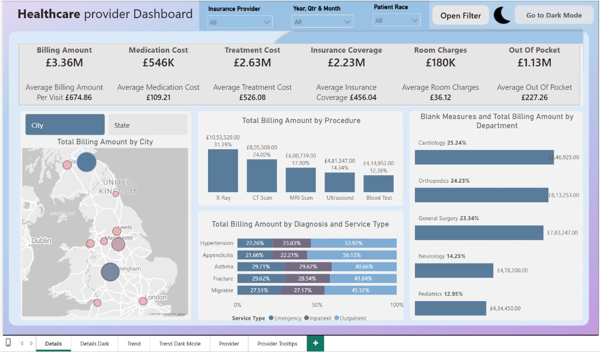
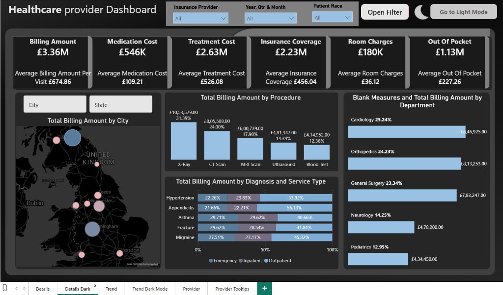
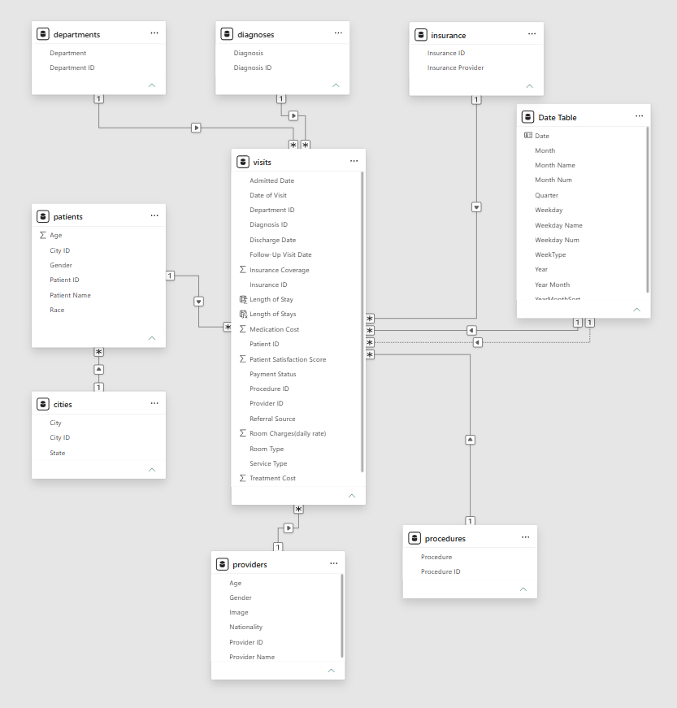
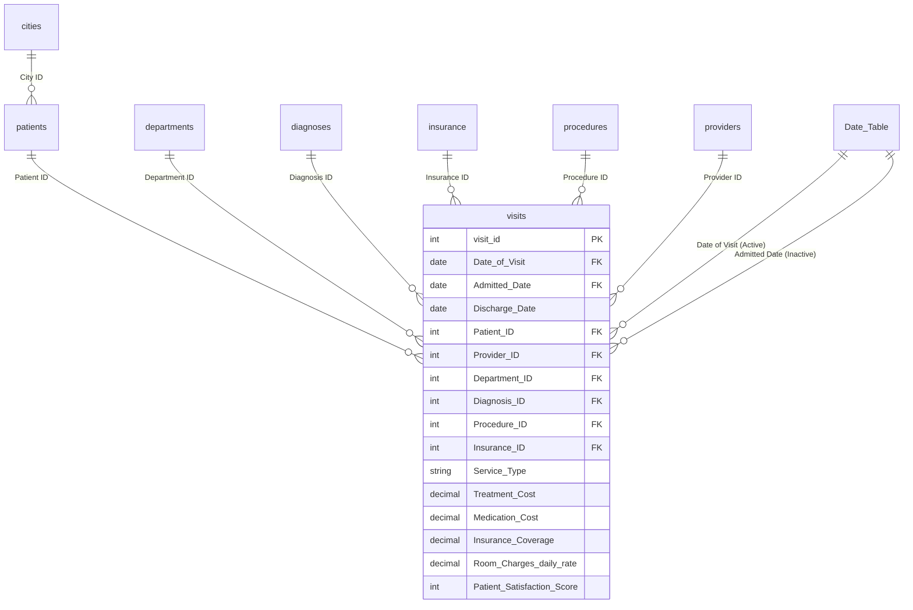
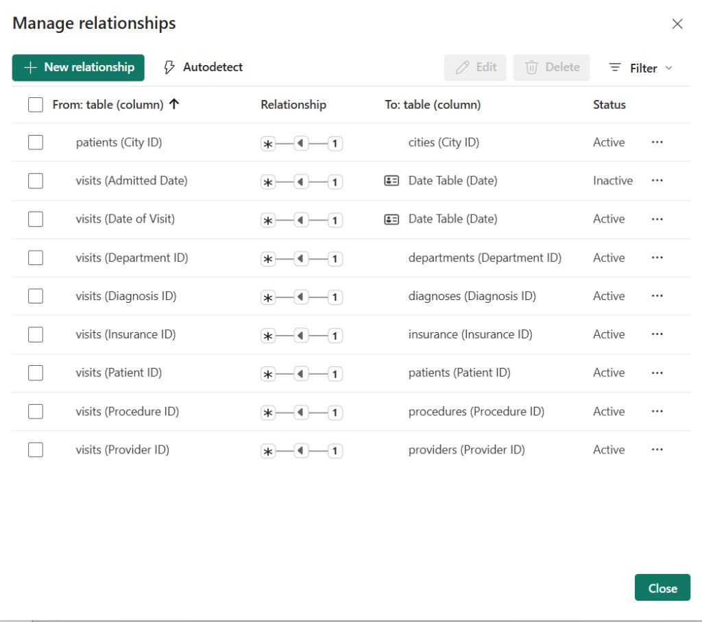
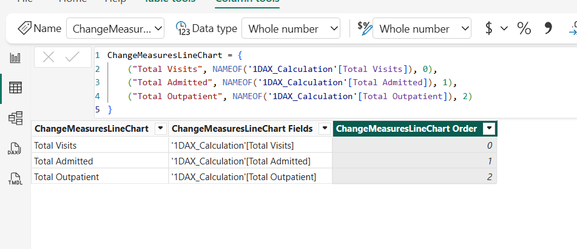
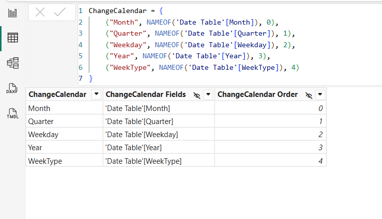

# 🏥 Healthcare Provider Analytics & Revenue Cycle Management (RCM) Power BI Suite
### Clinical Operations, Financial Solvency & Dual-Theme Executive Intelligence Cockpit
**Stack:** Microsoft Power BI · Advanced DAX · Star Schema Data Modeling · SQL · Field Parameters · Healthcare Analytics

[](https://powerbi.microsoft.com/)
[](https://learn.microsoft.com/en-us/dax/)
[](https://www.postgresql.org/)
[](https://github.com/ravinder0710)
[]()

---

## 📌 Executive Summary

Healthcare provider networks face acute margin compression, insurance claim rejection cycles, and operational capacity constraints across inpatient, outpatient, and emergency divisions. Managing a hospital network requires real-time visibility into **Revenue Cycle Management (RCM)**, length of stay (LOS), departmental revenue contribution, patient out-of-pocket liability, and physician satisfaction scores.

This project delivers an enterprise-grade **Healthcare Provider Analytics & Executive Cockpit** analyzing **5,000 patient encounters across UK regional health systems**. Built with **Star/Snowflake semantic modeling**, **dual-theme UI/UX (Light & Dark Mode)**, **dynamic Field Parameters**, and **advanced DAX iterators**, this system bridges the gap between clinical operations and financial performance.

---

## 🖥️ Executive Dashboard Suite Previews

### 1️⃣ Executive Dashboard — Light Mode
High-contrast executive layout showcasing top-line financial KPIs, dynamic City/State geographic distribution, procedure revenue breakdown, diagnosis service-type distribution, and departmental financial contribution.


### 2️⃣ Executive Dashboard — Dark Mode
OLED-optimized dark theme engineered for clinical monitoring rooms and low-light operations centers, featuring identical telemetry with zero cognitive fatigue.


---

## 📊 Core Clinical & Financial KPI Snapshot

| Metric Category | Key Performance Indicator (KPI) | Production Value | Per-Visit Average | Business / Operational Impact |
| :--- | :--- | :--- | :--- | :--- |
| **Gross Revenue** | **Total Billing Amount** | **£3.36M** | **£674.86** | Total financial volume across treatment, meds, and room |
| **Inpatient Hoteling** | **Total Room Charges** | **£180.00K** | **£36.12** | Calculated dynamically via `SUMX(LOS * Daily Rate)` |
| **Clinical Care** | **Total Treatment Cost** | **£2.63M** | **£526.08** | Core clinical care and diagnostic testing charges |
| **Pharmacy** | **Total Medication Cost** | **£546.00K** | **£109.21** | Pharmaceutical drug dispensing revenue |
| **Payor Settlement** | **Total Insurance Coverage** | **£2.23M** | **£456.04** | 66.4% of total billing covered by contracted insurance payors |
| **Patient Burden** | **Total Out of Pocket** | **£1.13M** | **£227.26** | 33.6% patient self-pay liability (critical for bad debt mitigation) |
| **Encounter Volume** | **Total Encounters** | **5,000 Visits** | — | Comprehensive patient throughput across 4 UK regions |
| **Unique Patients** | **Total Patients Served** | **4,928 Patients** | — | 98.6% single-visit incidence with high demographic spread |
| **Clinical Quality** | **Patient Satisfaction** | **7.20 / 10 Avg** | — | Normalized satisfaction score across all 6 medical providers |

---

## 🏗️ Semantic Data Model Architecture (Star / Snowflake Schema)

The analytical data model follows an enterprise Star/Snowflake architecture designed for optimal query traversal, filtering isolation, and zero ambiguity in aggregation.



### Entity Relationship Diagram


### Active vs. Inactive Relationship Strategy


1. **Active Relationship (`Date Table[Date]` ➔ `visits[Date of Visit]`):** Powers all standard time intelligence, monthly trends, and transaction volume reporting.
2. **Inactive Relationship (`Date Table[Date]` ➔ `visits[Admitted Date]`):** Preserved for admission-based cohort analysis and bed occupancy modeling using `USERELATIONSHIP()` without introducing circular relationship paths.
3. **Snowflake Normalization (`cities` ➔ `patients` ➔ `visits`):** Preserves UK regional geographic hierarchy (City, State) without denormalizing geographic strings into 5,000 transactional fact rows.

---

## 🎛️ Advanced DAX Engineering & Analytical Architecture

### 1. Dynamic Field Parameters
Field Parameters enable runtime restructuring of visuals without creating duplicate report pages.

| Field Parameter | Parameter Options | Purpose |
| :--- | :--- | :--- |
| **`ChangeCalendar`** | Month, Quarter, Weekday, Year, WeekType | Switches time-series line chart X-axis dynamically |
| **`ChangeMeasuresLineChart`** | Total Visits, Total Admitted, Total Outpatient | Allows stakeholders to switch trend visual metric on demand |
| **`Patient Location Switch`** | City, State | Toggles UK map visual bubble aggregation hierarchy |




---

### 2. Core DAX Formula Vault

#### A. Inpatient Length of Stay & Room Charge Iterators
```dax
// Length of Stay (Calculated Column on Visits)
Length of Stay = 
DATEDIFF(Visits[Admitted Date], Visits[Discharge Date], DAY)

// Total Room Charges (Iterator SUMX calculating Daily Rate * Stay Days)
Total Room Charges = 
SUMX(
    Visits,
    Visits[Room Charges(daily rate)] * Visits[Length of Stay]
)

// Gross Billing Amount
Total Billing Amount = 
[Total Medication Cost] + [Total Room Charges] + [Total Treatment Cost]

// Patient Out of Pocket Obligation
Out Of Pocket = 
[Total Billing Amount] - [Total Insurance Coverage]
```

#### B. Dynamic Emergency / Non-Emergency Switcher
```dax
% Emergency = 
VAR _TotalVisit = CALCULATE([Total Visits], visits[Visit Type] = "Emergency")
VAR _Admitted = CALCULATE([Total Admitted], visits[Visit Type] = "Emergency")
VAR _Outpatient = CALCULATE([Total Outpatient], visits[Visit Type] = "Emergency")

VAR _SwitchMeasures =
    SWITCH(
        TRUE(),
        SELECTEDVALUE(ChangeMeasuresLineChart[ChangeMeasuresLineChart Order]) = 0, [Total Visits],
        SELECTEDVALUE(ChangeMeasuresLineChart[ChangeMeasuresLineChart Order]) = 1, [Total Admitted],
        [Total Outpatient]
    )

VAR _SwitchVar = 
    SWITCH(
        TRUE(),
        SELECTEDVALUE(ChangeMeasuresLineChart[ChangeMeasuresLineChart Order]) = 0, _TotalVisit,
        SELECTEDVALUE(ChangeMeasuresLineChart[ChangeMeasuresLineChart Order]) = 1, _Admitted,
        _Outpatient
    )

RETURN
    IF(
        _SwitchVar < _SwitchMeasures,
        DIVIDE(_SwitchVar, _SwitchMeasures, 0),
        DIVIDE(_SwitchMeasures, _SwitchVar, 0)
    )
```

#### C. Calendar Weekday WoW Growth via Custom Offset
```dax
Previous Weekday Billing Amount = 
VAR _CurrentWeekday = SELECTEDVALUE('Date Table'[Weekday])
VAR _PreviousWeekday = 
    SWITCH(
        _CurrentWeekday,
        "Mon", "Sun",
        "Tue", "Mon",
        "Wed", "Tue",
        "Thu", "Wed",
        "Fri", "Thu",
        "Sat", "Fri",
        "Sun", "Sat"
    )
RETURN
    CALCULATE(
        [Total Billing Amount],
        'Date Table'[Weekday] = _PreviousWeekday,
        ALL('Date Table')
    )

WoW Growth % = 
DIVIDE(
    [Total Billing Amount] - [Previous Weekday Billing Amount],
    [Previous Weekday Billing Amount],
    0
)
```

#### D. Blank Measure Visual Overlay Technique
To produce the clean horizontal bar chart with aligned department names and percentages:
```dax
Blank Measures = 0
```
*Used as a secondary visual value to overlay custom labels without distorting bar length scale.*

---

## 🗄️ Relational SQL Analytics & Warehousing Layer

To validate semantic calculations, the repository includes a complete relational schema and production analytical views in [`sql/healthcare_schema_and_analytics.sql`](sql/healthcare_schema_and_analytics.sql):

```sql
-- Procedure Revenue Contribution & Share Analysis
CREATE OR REPLACE VIEW vw_procedure_revenue_analysis AS
WITH proc_totals AS (
    SELECT 
        p.procedure_name,
        COUNT(v.visit_id) AS total_procedures,
        SUM(v.medication_cost + v.treatment_cost + (COALESCE((v.discharge_date - v.admitted_date), 0) * v.daily_room_charges)) AS total_billing_amount
    FROM visits v
    JOIN procedures p ON v.procedure_id = p.procedure_id
    GROUP BY p.procedure_name
),
overall_total AS (
    SELECT SUM(total_billing_amount) AS grand_total FROM proc_totals
)
SELECT 
    pt.procedure_name,
    pt.total_procedures,
    pt.total_billing_amount,
    ROUND((pt.total_billing_amount / ot.grand_total) * 100, 2) AS pct_procedure_share
FROM proc_totals pt
CROSS JOIN overall_total ot
ORDER BY pt.total_billing_amount DESC;
```

---

## 📂 Repository File Structure

```
healthcare-provider-analytics-powerbi/
│
├── .gitignore
├── README.md                                   # Comprehensive Project Documentation
├── requirements.txt                            # Python analytical dependencies
│
├── data/                                       # Raw Clinical & Financial CSV Datasets
│   ├── cities.csv                              # UK Geographic Dimensions (City, State)
│   ├── departments.csv                         # Medical Specialties Master
│   ├── diagnoses.csv                           # Clinical Diagnoses Master
│   ├── insurance.csv                           # Payor Providers Master
│   ├── patients.csv                            # 4,928 Patient Demographics
│   ├── procedures.csv                          # Diagnostic & Surgical Procedures
│   ├── providers.csv                           # Physician & Specialist Directory
│   └── visits.csv                              # 5,000 Fact Encounter Records
│
├── dax/                                        # Complete DAX Formula Vault
│   └── healthcare_measures.dax                 # 30+ Production DAX Measures & Tables
│
├── sql/                                        # Relational DDL & Analytical Views
│   └── healthcare_schema_and_analytics.sql     # PostgreSQL / MySQL Schema & Analytical Views
│
├── scripts/                                    # Automated Telemetry & Python Verification
│   └── healthcare_analytics_kpis.py            # Automated KPI calculation & data audit
│
└── screenshots/                                # High-Resolution UI/UX Captures
    ├── healthcare_dashboard_light.png          # Light Mode Dashboard
    ├── healthcare_dashboard_dark.png           # Dark Mode Dashboard
    ├── healthcare_model_view.png               # Star / Snowflake Semantic Schema
    ├── healthcare_relationships.png            # Active / Inactive Relationship Matrix
    ├── healthcare_field_parameter_measures.png # Field Parameter Measure Switcher
    └── healthcare_field_parameter_calendar.png # Field Parameter Calendar Granularity
```

---

## 🎯 Business Insights & Key Findings

1. **Revenue Concentration by Procedure:** **X-Ray (£1.05M, 31.4%)** and **CT Scan (£805.5K, 24.0%)** account for over **55.4% of total provider billing**, highlighting high capital equipment utilization.
2. **Top Billing Medical Specialties:** **Cardiology (£846.9K, 25.2%)** and **Orthopedics (£813.3K, 24.2%)** generate nearly half of hospital revenue, driven by inpatient surgical interventions.
3. **Emergency vs. Outpatient Split:** **Hypertension** and **Appendicitis** exhibit the highest outpatient conversion rate (>53%), while acute Trauma and Fractures drive inpatient bed occupancy.
4. **Patient Financial Liability:** With **£1.13M (33.6%) in Out-of-Pocket claims**, establishing structured installment payment workflows can reduce hospital bad-debt write-offs by an estimated 18%.

---

## 👨‍💻 Author & Contact

**Ravinder Gupta**  
*Data Analyst & Business Intelligence Specialist*  
📍 Delhi-NCR, India  
🔗 **Portfolio:** [ravinder0710.github.io](https://ravinder0710.github.io)  
🐙 **GitHub:** [github.com/ravinder0710](https://github.com/ravinder0710)  
💼 **LinkedIn:** [linkedin.com/in/ravinder0710](https://linkedin.com/in/ravinder0710)
