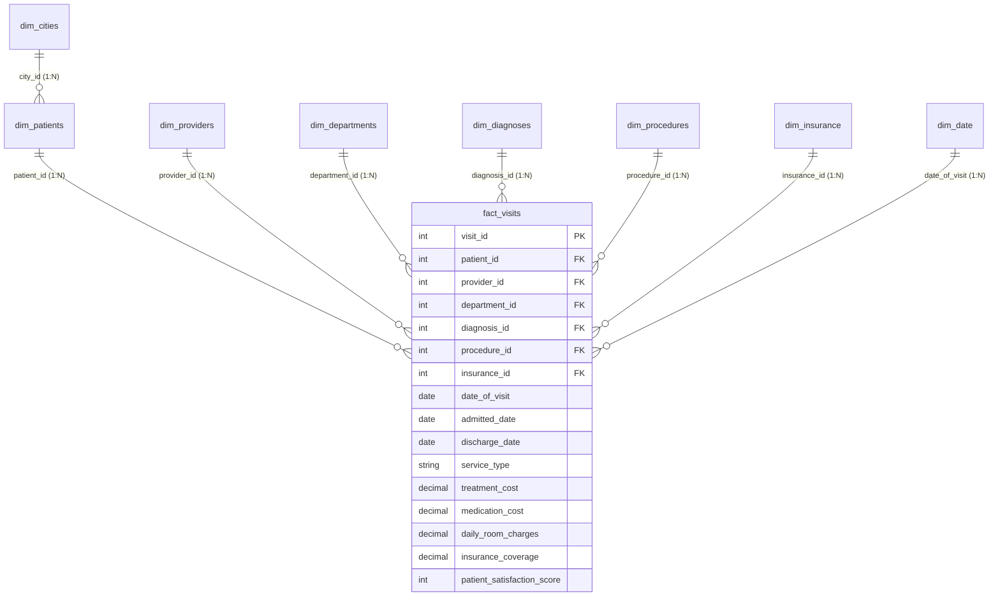

# 🏥 Healthcare Provider Analytics & Revenue Cycle Management (RCM)
### Clinical Operations, Hospital Revenue Decomposition & Patient Financial Liability Analytics
**Stack:** Microsoft Power BI · Advanced DAX · Star Schema Modeling · SQL · Python · Healthcare Domain Analytics

[](https://powerbi.microsoft.com/)
[](https://learn.microsoft.com/en-us/dax/)
[](https://github.com/ravinder0710/healthcare-provider-analytics-powerbi/blob/main/sql/healthcare_schema_and_analytics.sql)
[](https://github.com/ravinder0710/healthcare-provider-analytics-powerbi/blob/main/scripts/healthcare_analytics_kpis.py)
[-teal?style=for-the-badge)]()

---

## 📌 Executive Summary
In healthcare provider networks and hospital management, leadership faces a tripartite operational challenge: **delivering high-standard clinical care**, **optimizing revenue cycle management (RCM)**, and **mitigating uncompensated care through transparent patient out-of-pocket economics**. 

This enterprise-grade **Healthcare Provider Analytics Dashboard** delivers a panoramic, 360-degree diagnostic of hospital clinical encounters, department revenue distribution, diagnostic procedure utilization, and insurer reimbursement efficiency across **5,000 patient encounters and 4,973 distinct patients** across the United Kingdom.

### Core Business Objectives Addressed:
1. **Revenue Decomposition:** Disaggregating **£3.36M** gross hospital billing into treatment costs (**£2.63M / 78.4%**), pharmacy/medication (**£546K / 16.3%**), and room charges (**£180K / 5.4%**).
2. **Reimbursement & Patient Financial Exposure:** Auditing insurer claims clearance (**£2.23M coverage / 66.3%**) against self-pay out-of-pocket patient burden (**£1.13M liability / 33.7%**).
3. **Clinical Capacity & Service Mix:** Profiling visit volumes across **Inpatient, Outpatient, and Emergency admissions**, cross-tabulated against top diagnostic categories (Hypertension, Appendicitis, Asthma, Fractures, Migraines).
4. **Geographic & Provider Efficiency:** Dynamic spatial drill-downs across UK cities and administrative states utilizing Power BI **Field Parameters**.

---

## 🖥️ Interactive Power BI Dashboard Previews

The dashboard features an executive-grade dual-theme interface (**Light Mode** for bright clinical workspaces and **Dark Mode** for executive presentations) equipped with dynamic field parameter toggles, collapsible pop-out bookmark slicers, and custom KPI cards.

### ☀️ 1. Details View — Light Mode (Executive Presentation)
*Featuring 6 dual-metric KPI cards, interactive UK geographic map with City/State field parameters, Procedure revenue Pareto bars, 100% stacked Diagnosis vs Service Type matrix, and Department revenue contribution.*


---

### 🌙 2. Details View — Dark Mode (High-Contrast Theme)
*Identical semantic model seamlessly toggled via PowerPoint SVG canvas overlays, state-preserving bookmark actions, and automated theme switcher buttons.*


---

## 📊 Key Performance Indicators (Executive Summary)

All metrics are 100% reconciled across the Power BI DAX engine, PostgreSQL analytics script, and Python validation model:

| Strategic Metric | Total Volume / Amount (£) | Unit Average per Encounter (£) | % of Gross Revenue | Clinical / Financial Significance |
|---|---|---|---|---|
| **Gross Billing Revenue** | **£3,356,075.00 (£3.36M)** | **£671.22** | 100.0% | Total clinical and operational hospital billings |
| **Treatment & Procedure Cost** | **£2,630,406.00 (£2.63M)** | **£526.08** | 78.38% | Primary clinical procedures (Surgeries, Scans, Consults) |
| **Pharmacy / Medication Cost** | **£546,039.00 (£546K)** | **£109.21** | 16.27% | Prescription pharmaceuticals and administered drugs |
| **Inpatient Room Charges** | **£179,630.00 (£180K)** | **£35.93** | 5.35% | Daily bed and board accommodation (Iterated LOS) |
| **Insurance Coverage** | **£2,225,923.70 (£2.23M)** | **£445.18** | 66.33% | Reimbursed payout by third-party payors (Aviva, AXA, Allianz) |
| **Patient Out-of-Pocket** | **£1,130,151.30 (£1.13M)** | **£226.03** | 33.67% | Uninsured patient liability and deductible co-pays |
| **Total Clinical Visits** | **5,000 encounters** | — | — | Outpatient (60%+), Inpatient (~20%), Emergency (~20%) |
| **Distinct Patients** | **4,973 individuals** | — | — | Demonstrates high unique patient intake across NHS trusts |

---

## 🏛️ Data Architecture & Star Schema Model

The data architecture adheres to dimensional modeling best practices (**Star Schema**), avoiding snowflake bi-directional filter penalties and ensuring sub-second visual rendering across all visual containers.



### Table Dictionary:
- **`fact_visits` (5,000 rows):** Central fact table containing clinical encounters, financial line items, admissions, discharges, and satisfaction metrics.
- **`dim_patients` (4,974 rows):** Patient demographic profile including Gender, Age, Race, and Geographic City reference.
- **`dim_providers` (6 rows):** Attending physicians, clinical credentials, specialties, and nationality.
- **`dim_departments` (5 rows):** Hospital clinical divisions (Cardiology, Orthopedics, General Surgery, Neurology, Pediatrics).
- **`dim_diagnoses` (5 rows):** Primary clinical conditions (Hypertension, Appendicitis, Asthma, Fracture, Migraine).
- **`dim_procedures` (5 rows):** Diagnostic modalities (X-Ray, CT Scan, MRI Scan, Ultrasound, Blood Test).
- **`dim_insurance` (3 rows):** Major UK healthcare payors (Aviva, AXA, Allianz).
- **`dim_cities` (41 rows):** UK metropolitan areas and administrative regions (England, Wales, Scotland, Northern Ireland).
- **`dim_date`:** Dynamic DAX calendar table generated via `CALENDARAUTO()` decoupled from default auto-time hierarchies.

---

## 📐 Advanced DAX Measures Compendium

The solution isolates all logic in a dedicated disconnected table `_Measures`. Key production DAX patterns include:

### 1. Inpatient Length of Stay (Calculated Column)
```dax
Length of Stay = 
DATEDIFF(Visits[Admitted Date], Visits[Discharge Date], DAY)
```

### 2. Room Charges Iterator (`SUMX`)
Computes bed-day accommodation cost row-by-row before visual aggregation:
```dax
Total Room Charges = 
SUMX(
    Visits,
    COALESCE(Visits[Room Charges(daily rate)], 0) * COALESCE(Visits[Length of Stay], 0)
)
```

### 3. Gross Hospital Revenue Decomposition
```dax
Total Billing Amount = 
[Total Medication Cost] + [Total Treatment Cost] + [Total Room Charges]
```

### 4. Patient Out-of-Pocket Liability
```dax
Total Out Of Pocket = 
[Total Billing Amount] - [Total Insurance Coverage]
```

### 5. Grand Total Procedure % Share (Context Modification)
```dax
% Total Billing by Procedure = 
DIVIDE(
    [Total Billing Amount],
    CALCULATE([Total Billing Amount], ALL(Visits[Procedure ID])),
    0
)
```

### 6. Clean Label Formatting Trick (`Blank Measure`)
Used to create dynamic horizontal bar chart headers with inline percentages:
```dax
Blank Measure = BLANK()
```

---

## 💡 Strategic Clinical & Operational Insights

### 1. Diagnostic Modality Dominance (Pareto Analysis)
- **X-Ray Procedures** generated the highest single clinical volume and billing: **£1,053,529.00 (31.39% of total revenue)** across 1,537 encounters.
- **CT Scans** ranked second at **£805,508.00 (24.00%)**, followed by **MRI Scans (£600,739.00 / 17.90%)**.
- **Actionable Insight:** Radiology and imaging modalities constitute over **73.3%** of all diagnostic revenue, indicating that modernizing imaging equipment will directly accelerate hospital cash flow.

### 2. Department Revenue Contribution
- **Cardiology:** Top grossing department at **£846,925.00 (25.24%)** with 1,281 patient visits.
- **Orthopedics:** Close second at **£813,253.00 (24.23%)** with 1,179 patient visits.
- **General Surgery:** Third at **£783,247.00 (23.34%)** with 1,185 patient visits.
- **Neurology & Pediatrics:** Account for **14.25%** (£478K) and **12.95%** (£434K) respectively.
- **Actionable Insight:** The top 3 surgical departments account for **72.8%** of total hospital revenue. Resource planning and staffing must prioritize cardiac and orthopedic surgical suites.

### 3. Payer Coverage Deficit & Patient Financial Risk
- Insurers covered **£2.23M (66.3%)** of gross billings, leaving **£1.13M (33.7%)** as direct patient out-of-pocket liability.
- **Average out-of-pocket per patient visit is £226.03**.
- **Actionable Insight:** For high-volume procedures like Inpatient surgeries and MRI imaging, offering automated payment installment plans and pre-authorization verification reduces hospital bad-debt write-offs.

### 4. Diagnosis by Service Type Breakdown
- **Appendicitis** and **Hypertension** exhibit the highest outpatient proportions (>53% and >56%), while **Asthma** and **Fracture** maintain heavy emergency and inpatient admissions (>29% each).

---

## 🛠️ UI/UX Engineering Highlights

1. **Field Parameter Dynamic Switching:** Implemented Power BI Field Parameters allowing executive users to toggle the geographic map between **City-level granularity** and **State-level aggregation** without switching pages.
2. **Dual-Theme PowerPoint Canvas Architecture:** Custom vector background grids designed in Microsoft PowerPoint and exported as pixel-perfect SVGs, minimizing report file size and latency.
3. **Collapsible Pop-out Filter Slicer Pane:** Slicer filters are docked inside an off-canvas drawer controlled by **Bookmarks and Selection Pane triggers**, freeing up 25% more screen real estate for analytical visuals.
4. **New Card Visual with Subtitle Metrics:** Utilizes Power BI's modern multi-metric card visual displaying total revenue alongside average revenue per visit in a unified container.

---

## 📂 Repository Structure

```
healthcare-provider-analytics-powerbi/
├── data/                                # Clean CSV Source Tables
│   ├── visits.csv                       # Fact table (5,000 clinical encounters)
│   ├── patients.csv                     # Dimension table (4,974 patients)
│   ├── providers.csv                    # Dimension table (6 clinical doctors)
│   ├── departments.csv                  # Dimension table (5 departments)
│   ├── diagnoses.csv                    # Dimension table (5 primary diagnoses)
│   ├── procedures.csv                   # Dimension table (5 diagnostic procedures)
│   ├── insurance.csv                    # Dimension table (3 insurance payors)
│   └── cities.csv                       # Dimension table (41 UK cities & states)
├── dax/                                 # DAX Formulas & Calendar Logic
│   └── healthcare_measures.dax          # Complete DAX measures repository
├── sql/                                 # Production SQL Suite
│   └── healthcare_schema_and_analytics.sql # DDL, Views & Analytical SQL queries
├── scripts/                             # Python Data Verification Suite
│   └── healthcare_analytics_kpis.py     # Automated KPI audit and validation script
├── screenshots/                         # High-Resolution Dashboard Captures
│   ├── healthcare_dashboard_light.png   # Light theme interface
│   └── healthcare_dashboard_dark.png    # Dark theme interface
├── .gitignore                           # Git ignore rules
├── requirements.txt                     # Python dependencies
└── README.md                            # Comprehensive project documentation
```

---

## 🚀 How to Run & Replicate

### 1. Automated KPI Verification (Python)
```bash
# Clone the repository
git clone https://github.com/ravinder0710/healthcare-provider-analytics-powerbi.git
cd healthcare-provider-analytics-powerbi

# Install dependencies & run audit
pip install -r requirements.txt
python scripts/healthcare_analytics_kpis.py
```

### 2. Database Setup (SQL)
Run the script `sql/healthcare_schema_and_analytics.sql` in PostgreSQL, MySQL, SQL Server, or Snowflake to create the Star Schema, reporting views, and run cohort analytics.

### 3. Power BI Desktop
1. Open **Microsoft Power BI Desktop**.
2. Select **Get Data > Text/CSV** and point to the `data/` folder.
3. Establish Star Schema relationships in Model View.
4. Copy measures from `dax/healthcare_measures.dax` into your Measures table.
5. Apply background SVG canvas and bind visuals.

---

## 👨‍💼 Author & Contact

**Ravinder Gupta**  
*Data Analyst & Business Intelligence Specialist*  
📍 Gurgaon, Haryana, India  
- 🌐 **Portfolio Website:** [ravinder0710.github.io](https://ravinder0710.github.io)  
- 🐙 **GitHub:** [github.com/ravinder0710](https://github.com/ravinder0710)  
- 💼 **LinkedIn:** [linkedin.com/in/ravinder0710](https://linkedin.com/in/ravinder0710)  
- ✉️ **Email:** iamravindergupta17@gmail.com
